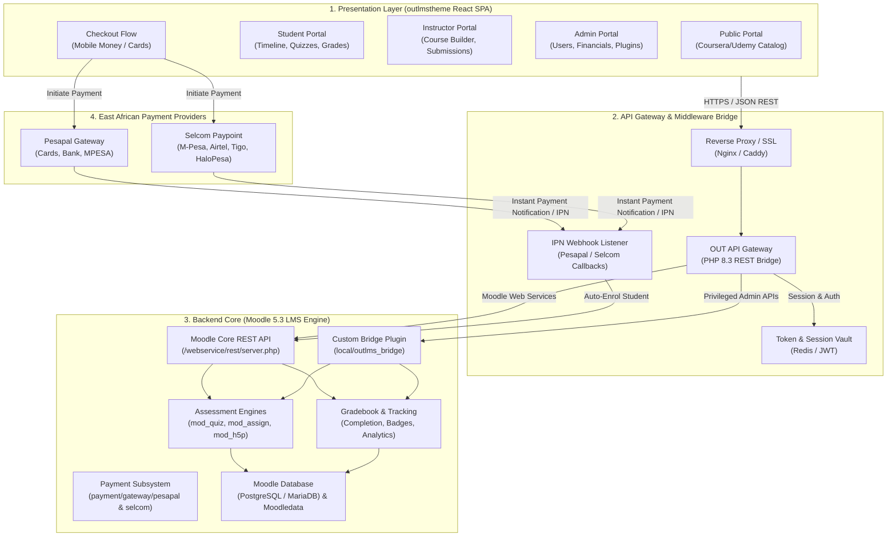
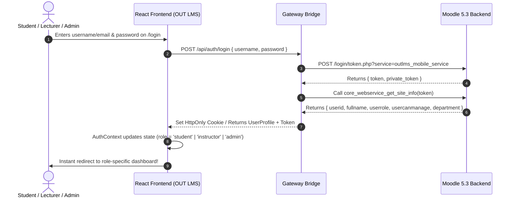
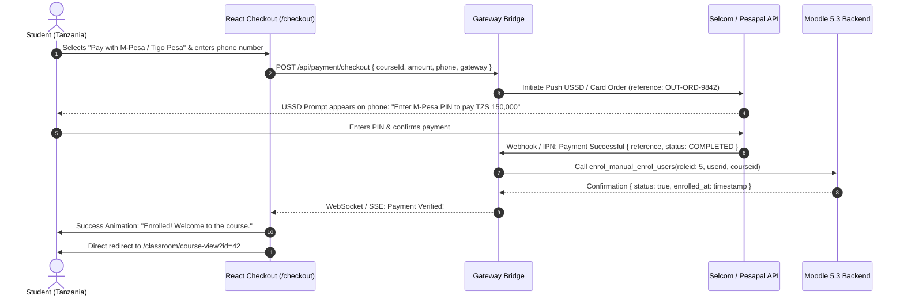
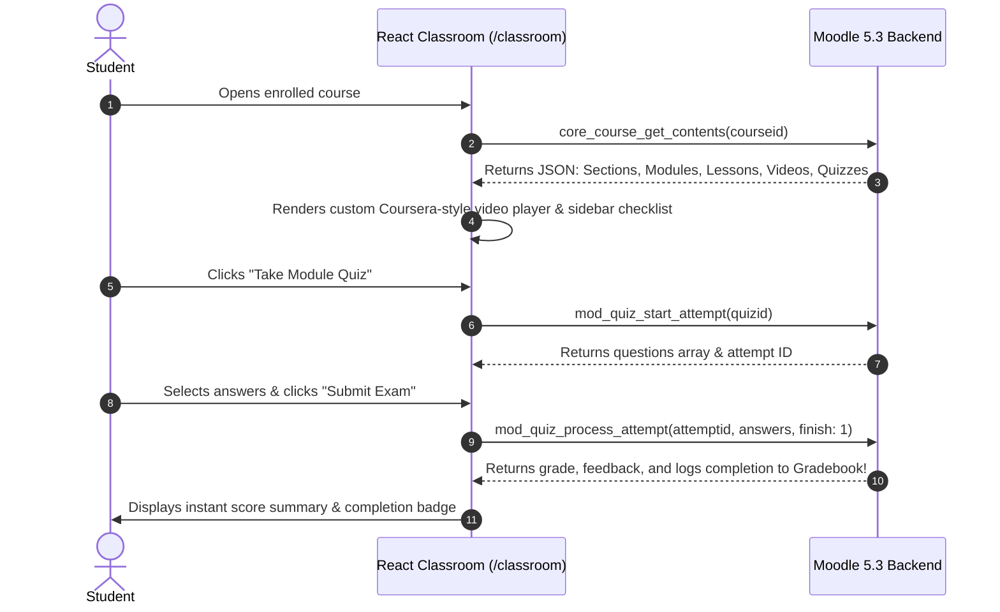
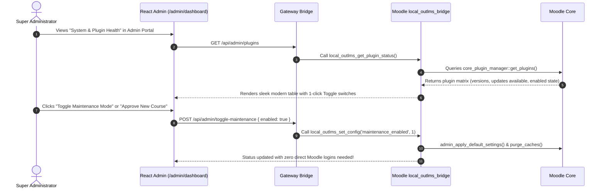

# Open University of Tanzania (OUT) LMS
## Enterprise Headless Architecture & System Design Document

> [!IMPORTANT]
> **Mission Statement**: Transform the Open University of Tanzania's e-learning experience by marrying a **Coursera/Udemy-grade modern React frontend** with the **Moodle 5.3 academic, compliance, and grading engine**. The end user never sees or interacts with Moodle's default interface; all operations are executed via secure REST APIs and custom bridge plugins.

---

## 1. High-Level System Architecture



---

## 2. Comprehensive Directory & File Structure

Here is the exact structural organization for the complete enterprise ecosystem, cleanly segregated between the **Frontend Application**, the **Middleware / Gateway**, and the **Moodle 5.3 Backend Engine**.

```text
/out-lms-platform/
│
├── 📂 frontend/                           # Current React Application (outlmstheme)
│   ├── 📂 public/
│   │   ├── favicon.png
│   │   ├── index.html                    # Root HTML with OUT branding & meta tags
│   │   └── assets/                       # Static images, university logos, webfonts
│   ├── 📂 src/
│   │   ├── 📂 core/                      # Core infrastructure
│   │   │   ├── 📂 api/                   # [NEW] Moodle API Client & Service Abstraction
│   │   │   │   ├── apiClient.ts          # Axios / Fetch client with Moodle token injection
│   │   │   │   ├── moodleEndpoints.ts    # URLs for core and custom web service functions
│   │   │   │   ├── courseService.ts      # Categories, courses, course contents, syllabus
│   │   │   │   ├── studentService.ts     # Enrolled courses, timeline, quiz attempts, grades
│   │   │   │   ├── instructorService.ts  # Grading, submissions, course moderation
│   │   │   │   ├── adminService.ts       # User creation, role assignment, plugin status
│   │   │   │   └── paymentService.ts     # Pesapal & Selcom checkout initialization
│   │   │   ├── 📂 auth/                  # State management for users and roles
│   │   │   │   ├── authContext.tsx       # AuthProvider, useAuth hook, session persistence
│   │   │   │   ├── demoUsers.ts          # Realistic mock profiles (fallback/offline mode)
│   │   │   │   └── tokenStorage.ts       # Secure storage for Moodle WS tokens & cookies
│   │   │   ├── 📂 common/                # Shared layout components
│   │   │   │   ├── 📂 header/            # Dynamic Role-Based Header (Student, Instructor, Admin)
│   │   │   │   ├── 📂 footer/            # Unified OUT LMS Footer
│   │   │   │   ├── 📂 modal/             # Video modals, confirmation dialogs, payment prompts
│   │   │   │   └── 📂 breadcrumb/        # Contextual breadcrumbs
│   │   │   └── 📂 data/                  # Static navigation JSON & dictionary lookups
│   │   │
│   │   ├── 📂 feature-module/            # Role-Specific Feature Modules
│   │   │   ├── 📂 HomePages/             # Marketing & Public Discovery
│   │   │   │   └── 📂 home/              # Hero banner, category browser, top courses, testimonials
│   │   │   ├── 📂 courses/               # Course catalog, search filters, course details
│   │   │   ├── 📂 classroom/             # [NEW] Headless Course Player (Videos, PDFs, H5P, Quiz)
│   │   │   │   ├── CourseViewer.tsx      # Main lesson viewer container
│   │   │   │   ├── VideoPlayer.tsx       # Embedded video player with progress ping
│   │   │   │   ├── QuizAttempt.tsx       # Headless quiz engine consuming mod_quiz
│   │   │   │   └── AssignmentSubmit.tsx  # File upload & text submission to Moodle
│   │   │   ├── 📂 student/               # Student Portal
│   │   │   │   ├── 📂 common/            # studentSidebar.tsx, profileCard.tsx
│   │   │   │   ├── 📂 dashboard/         # studentDashboard.tsx (Progress, upcoming exams)
│   │   │   │   ├── 📂 student-course/    # Enrolled courses & completed certificates
│   │   │   │   └── 📂 student-quiz/      # Past exam results and grading breakdowns
│   │   │   ├── 📂 Instructor/            # Instructor / Faculty Portal
│   │   │   │   ├── 📂 common/            # instructorSidebar.tsx, profileCard.tsx
│   │   │   │   ├── 📂 instructor-dashboard/ # Student roster, submission alerts, analytics
│   │   │   │   ├── 📂 course-builder/    # Headless course creator (sections, modules)
│   │   │   │   └── 📂 grading/           # Assignment rubric evaluation & grade entry
│   │   │   ├── 📂 admin/                 # Super Administrator Portal
│   │   │   │   ├── 📂 common/            # adminSidebar.tsx
│   │   │   │   ├── adminDashboard.tsx    # University metrics, enrollment counters
│   │   │   │   ├── userManagement.tsx    # Add/edit students, lecturers, assign roles
│   │   │   │   ├── pluginDirectory.tsx   # View Moodle plugins status (enabled/disabled)
│   │   │   │   └── systemSettings.tsx    # University academic calendar, semester locks
│   │   │   ├── 📂 checkout/              # Payment & Enrollment Workflow
│   │   │   │   ├── Cart.tsx              # Course basket
│   │   │   │   ├── Checkout.tsx          # Tanzanian Mobile Money / Card selector
│   │   │   │   └── PaymentCallback.tsx   # Receipt verification & auto-redirect to course
│   │   │   └── 📂 router/                # All application routes and protected route guards
│   │   ├── App.tsx                       # Root React router
│   │   └── index.tsx                     # Entry point wrapping Redux & AuthProvider
│   ├── package.json
│   └── tsconfig.json
│
├── 📂 gateway-bridge/                     # [NEW] Lightweight Middleware / Orchestrator (PHP 8.3)
│   ├── 📂 src/
│   │   ├── 📂 Controllers/
│   │   │   ├── AuthController.php        # Exchanges user credentials for Moodle WS Token
│   │   │   └── PaymentController.php     # Pesapal & Selcom checkout + IPN webhooks
│   │   └── 📂 Services/
│   │       └── MoodleClient.php          # Secure server-to-server call to Moodle Web Services
│   ├── index.php                         # Front controller / REST router
│   ├── config.php                        # Environment & Moodle credentials
│   └── .env.example
│
└── 📂 moodle-backend/                     # Moodle 5.3 Core Engine
    ├── 📂 admin/                         # Native Moodle site administration & CLI scripts
    │   └── 📂 cli/                       # purge_caches.php, upgrade.php, install_plugin.php
    ├── 📂 local/
    │   └── 📂 outlms_bridge/             # [NEW] Custom OUT LMS Moodle Plugin
    │       ├── version.php               # Plugin version & Moodle requirements
    │       ├── db/
    │       │   ├── services.php          # Declares custom External Functions for Web Services
    │       │   └── access.php            # Defines custom capabilities
    │       ├── classes/
    │       │   └── external/
    │       │       ├── admin_api.php     # Exposes plugin management & site config to React
    │       │       ├── payment_api.php   # Handles custom fee transactions
    │       │       └── analytics_api.php # Generates aggregated university statistics
    │       └── lang/en/local_outlms_bridge.php
    ├── 📂 payment/
    │   └── 📂 gateway/
    │       ├── 📂 pesapal/               # [NEW] Moodle Native Pesapal Gateway Plugin
    │       │   ├── version.php
    │       │   ├── classes/gateway.php   # Implements \core_payment\gateway
    │       │   └── ipn.php               # IPN listener endpoint
    │       └── 📂 selcom/                # [NEW] Moodle Native Selcom Gateway Plugin
    │           ├── version.php
    │           ├── classes/gateway.php
    │           └── webhook.php
    ├── 📂 webservice/                    # Native Moodle REST endpoint (/webservice/rest/server.php)
    ├── config.php                        # Database connection & filedir configuration
    └── ... (Standard Moodle 5.3 core directories: course, mod, enrol, user, theme)
```

---

## 3. End-to-End Operational Workflows

### Workflow 1: Authentication & Role Discovery


---

### Workflow 2: Course Purchase & Instant Enrollment via Mobile Money (Pesapal / Selcom)


---

### Workflow 3: Headless Course Consumption (Classroom Engine)


---

### Workflow 4: Administrator Headless Operations


---

## 4. Moodle Core Web Services Function Mapping

Below is the definitive reference table connecting every React view directly to its corresponding Moodle 5.3 Web Service function:

| React View / Feature | Moodle 5.3 Core Web Service Function | Purpose |
|---|---|---|
| **Course Catalog & Categories** | `core_course_get_categories`<br/>`core_course_get_courses` | Fetches faculties, departments, and course list with thumbnails and prices |
| **Course Details Page** | `core_course_get_course_module`<br/>`core_course_get_contents` | Retrieves full course syllabus, sections, lessons, and activity outlines |
| **Student Dashboard** | `core_course_get_enrolled_courses_by_timeline`<br/>`core_completion_get_course_completion_status` | Returns active courses, percentage complete, and upcoming due dates |
| **Headless Quiz Player** | `mod_quiz_get_quizzes_by_courses`<br/>`mod_quiz_start_attempt`<br/>`mod_quiz_process_attempt` | Starts an exam attempt, records student answers, submits and auto-grades |
| **Assignment Submission** | `mod_assign_get_assignments`<br/>`mod_assign_save_submission` | Displays essay prompts, rubric guides, and accepts PDF/file uploads |
| **Gradebook & Results** | `gradereport_user_get_grade_items`<br/>`core_grades_get_grades` | Pulls weighted grades, GPA metrics, lecturer remarks, and certificates |
| **Instructor Course Builder** | `core_course_create_courses`<br/>`core_course_update_courses`<br/>`core_course_create_categories` | Allows lecturers to publish new courses and structure modules headlessly |
| **Instructor Grading Desk** | `mod_assign_get_submissions`<br/>`mod_assign_save_grade` | Displays student submissions and saves marks directly into Moodle gradebook |
| **Admin User Management** | `core_user_create_users`<br/>`core_user_update_users`<br/>`core_role_assign_roles` | Provisions student, teacher, and administrative accounts with roles |
| **Instant Enrollment (Post-Pay)**| `enrol_manual_enrol_users` | Instantly enrols student into course upon Pesapal/Selcom payment confirmation |
| **Messaging & Announcements** | `core_message_send_instant_messages`<br/>`mod_forum_get_forum_discussions` | Real-time notifications, university broadcast news, and forum threads |

---

## 5. Security & Multi-Role Access Model

1. **Token Scope Segregation:**
   * **Students:** Issue tokens restricted strictly to student-level services (`moodle/course:view`, `mod/quiz:attempt`, `mod/assign:submit`).
   * **Instructors:** Issue tokens with editing capabilities (`moodle/course:update`, `mod/assign:grade`).
   * **Administrators:** Require Multi-Factor Authentication (MFA) via SMS OTP / Authenticator before granting admin bridge tokens.
2. **Data Privacy & Compliance (TCU & Data Protection):**
   * All student academic records, exam logs, and grade data remain strictly within Moodle's relational database.
   * Student payment information (card numbers, PINs) is handled 100% off-site by Pesapal and Selcom compliant PCI-DSS gateways.

---

## 6. Recommended Phased Implementation Roadmap

```text
[Phase 1: React API Service Layer]
  └── Centralize current mock data into `src/core/api/` with Moodle response models.
  └── Enable live switching between Mock Mode and Moodle API Mode via .env.

[Phase 2: Moodle 5.3 Local Instance & Web Services Setup]
  └── Install clean Moodle 5.3 (PHP 8.2+, MariaDB/Postgres).
  └── Enable Web Services and create the `outlms_mobile_service` service user.
  └── Test basic endpoints (getCategories, getCourses) via Postman/cURL.

[Phase 3: The Custom Moodle Bridge Plugin (`local_outlms_bridge`)]
  └── Scaffold `local/outlms_bridge/` in Moodle.
  └── Expose custom administrative functions (plugin manager status, site settings).

[Phase 4: Tanzanian Payment Gateway Integration (Pesapal & Selcom)]
  └── Implement IPN Webhook listener in the gateway bridge.
  └── Test sandbox M-Pesa, Airtel Money, and Card checkouts with auto-enrolment.

[Phase 5: Final Headless Polish & University UAT]
  └── Conduct load testing for simultaneous quiz submissions.
  └── Roll out to the Open University of Tanzania staging server.
```
